# GlucoTwin 🩺
### A Continuously Updating, Patient-Conditioned Digital Twin for Glucose Event Prediction

**From reactive glucose monitoring to predictive, data-driven health research.**

GlucoTwin is a research prototype that combines historical patient context with an evolving stream of continuous glucose monitoring (CGM) observations to estimate the probability of a defined glucose event within the next two hours.

Rather than presenting a static risk score, GlucoTwin maintains a timestamped patient state, updates its features as new observations arrive, evaluates a trained machine-learning model, exposes model sensitivity, handles missing sensor data, and records predictions in a persistent audit log.

The project brings together a complete experimental pipeline: synthetic patient generation, causal temporal feature engineering, patient-level evaluation, model calibration, scenario analysis, interactive replay, and reproducible reporting.

> **Research disclaimer:** All patients, profiles, sensor readings, laboratory values, and events are synthetic. GlucoTwin is not a medical device and has not been clinically validated. It does not diagnose, prescribe treatment, or demonstrate improved clinical outcomes.

---

##  Explore GlucoTwin

| Resource | Description |
|---|---|
|  **Demo video (24 minute walkthrough)** | [Watch the narrated application walkthrough](https://www.youtube.com/watch?v=yD8jaq5B5u8) |
|  **Architecture** | [Architecture diagram (PDF)](docs/ARCHITECTURE.pdf) |
|  **Presentation** | [Project presentation (PDF)](docs/GLUCOTWIN_PRESENTATION.pdf) |
|  **Methodology** | [Experimental methodology](docs/METHODOLOGY.md) |
|  **Data dictionary** | [Features and data definitions](docs/DATA_DICTIONARY.md) |
|  **Model card** | [Model details, intended use, and limitations](docs/MODEL_CARD.md) |
|  **Demo script** | [Complete narration script](docs/DEMO_SCRIPT.md) |
|  **Submission checklist** | [Repository and submission checklist](docs/SUBMISSION_CHECKLIST.md) |

**Project:** GlucoTwin  
**Team:** Team MeowMeow  
**Challenge:** Happiest Health Digital Twin Challenge 2026

---

##  Application Showcase

All screenshots are captured from the GlucoTwin application. All patient data and sensor observations are synthetic.

### 01. Executive Overview

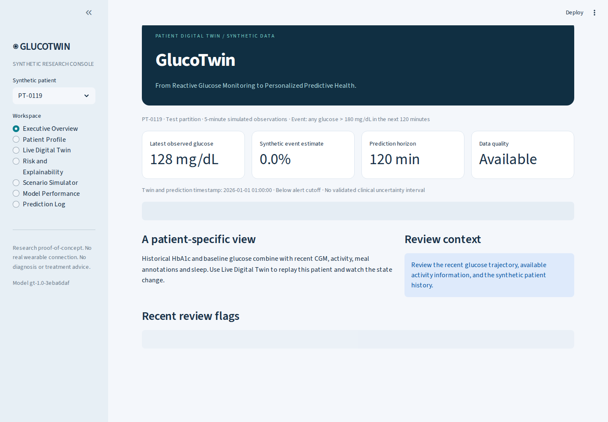

The main dashboard summarizes the latest synthetic glucose observation, estimated event probability, simulation timestamp, and data-quality status.

### 02. Patient Profile

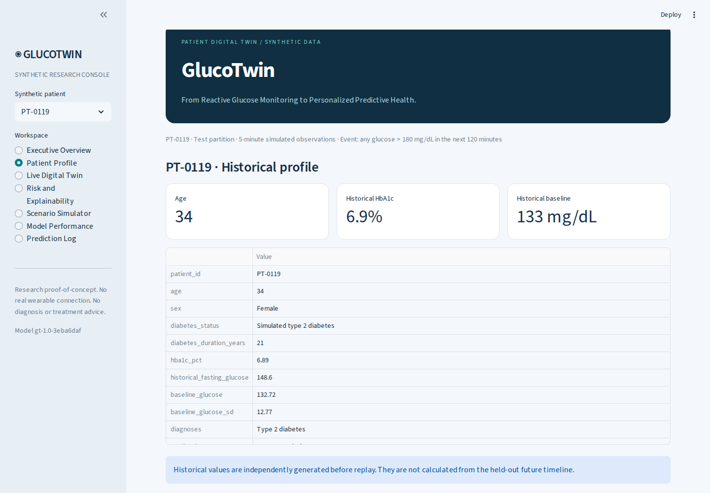

Each synthetic patient has a persistent identifier connecting historical patient characteristics to a separate sensor timeline.

### 03. Live Digital Twin


The live replay updates the observed glucose trace and prediction as simulated sensor observations arrive. Start/Resume, Pause, Step, Advance, and Reset support controlled inspection of the evolving state.

### 04. Feature Engineering and State Inspection

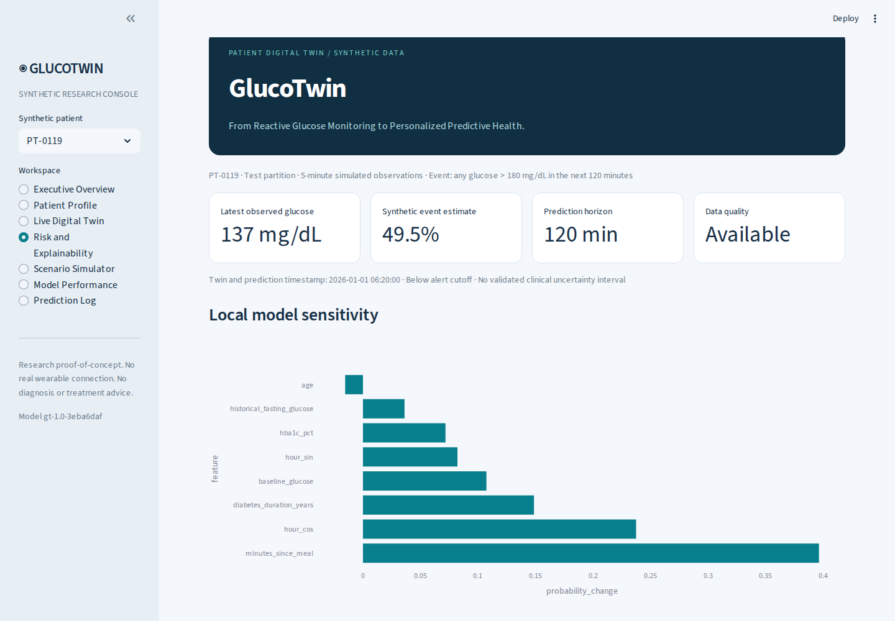

The feature pipeline combines recent glucose statistics, temporal trends, activity observations, meal timing, and historical context. Features are constructed using only information available at the prediction timestamp.

### 05. Explainability and Model Sensitivity


Local sensitivity analysis examines how replacing individual features with their training-set medians changes the model estimate. These results are model probes, not causal explanations or SHAP values.

### 06. Scenario Simulator

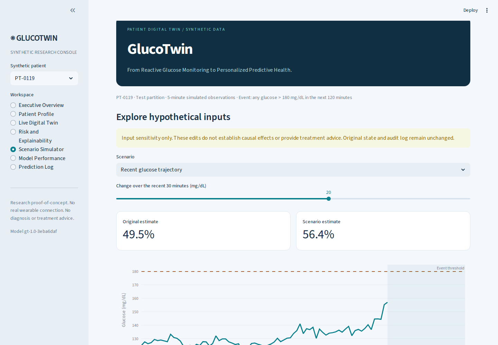

Scenario analysis modifies a copy of the observed input history, rebuilds the engineered features, and compares model estimates without altering the original replay state.

### 07. Model Performance and Evaluation


The evaluation dashboard presents held-out synthetic test metrics and model comparisons. The results demonstrate performance on the generated dataset only, not clinical validity.

### Additional application captures

<details>
<summary>Explore more screenshots</summary>

**Live replay — initial state**

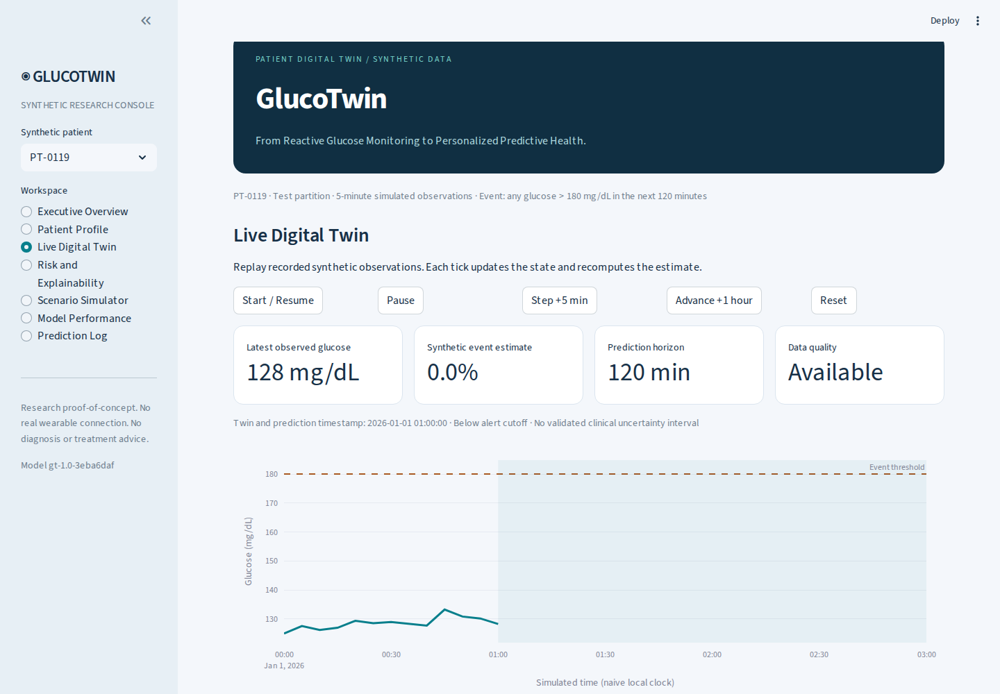

**Live replay — single-step update**

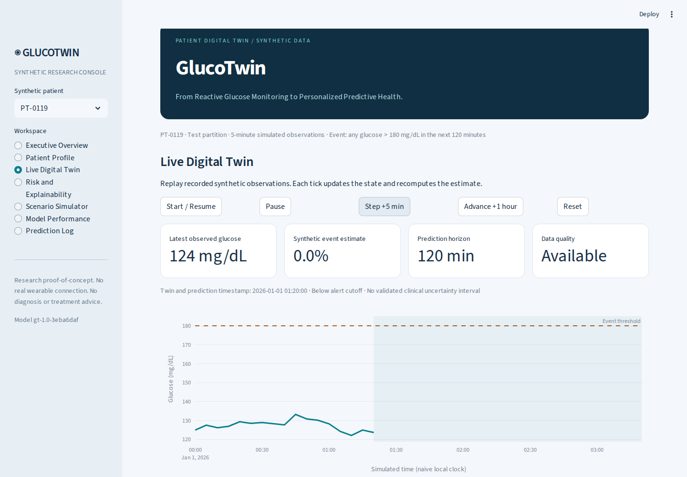

**Live replay — meal annotation**

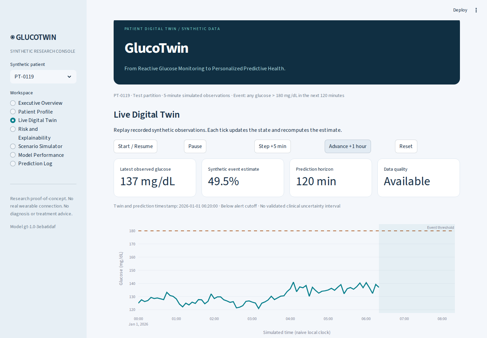

**Prediction log**

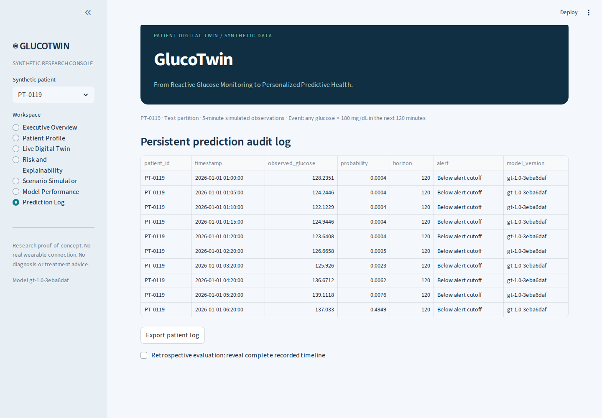

**Model calibration**


**Feature importance**

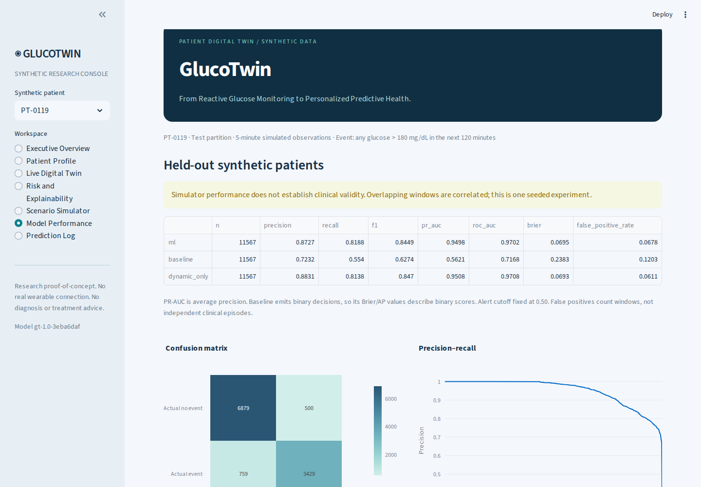

**Scenario — meal**

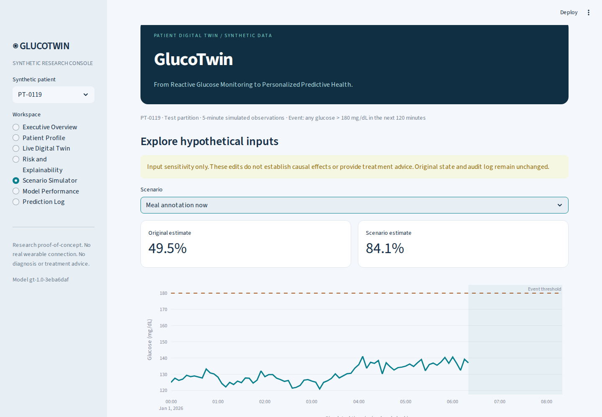

**Scenario — activity**

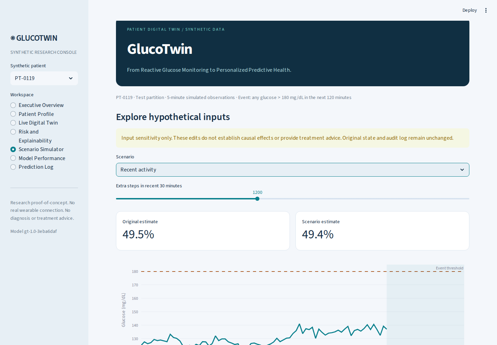

**Scenario — missing sensor data**

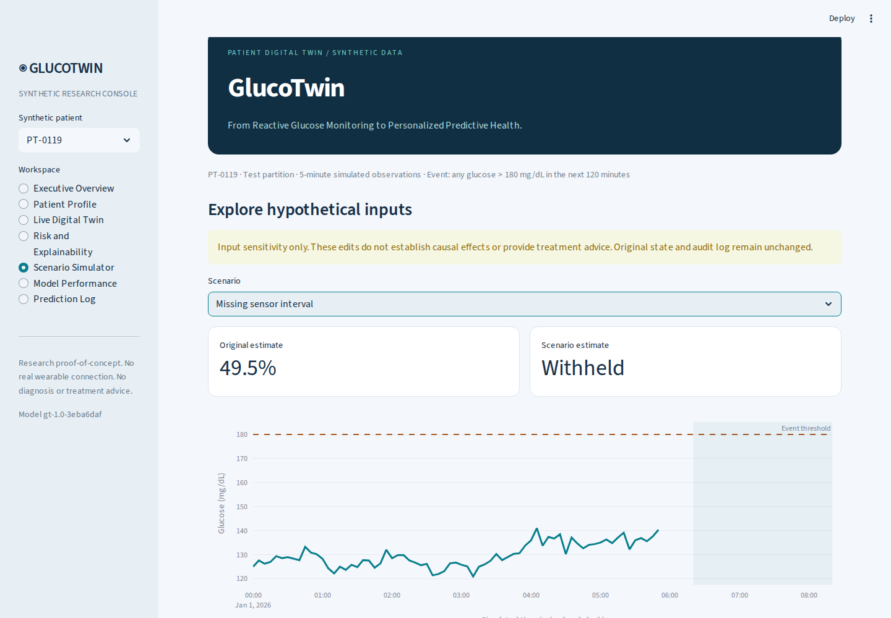

**Scenario — historical patient profile**


**Retrospective inspection**

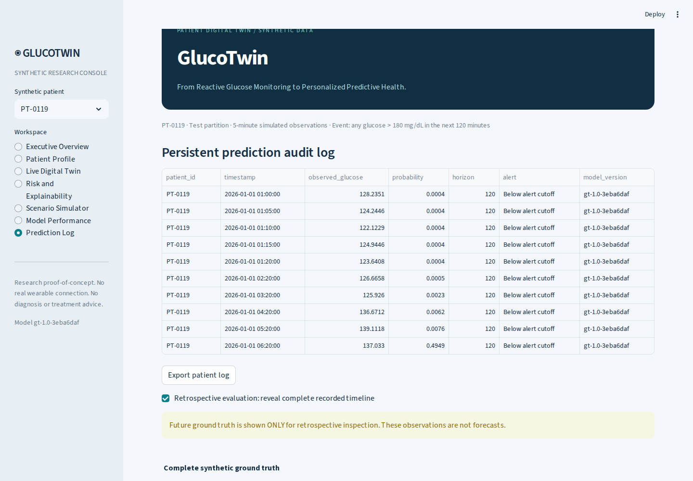

**Internal state inspector**

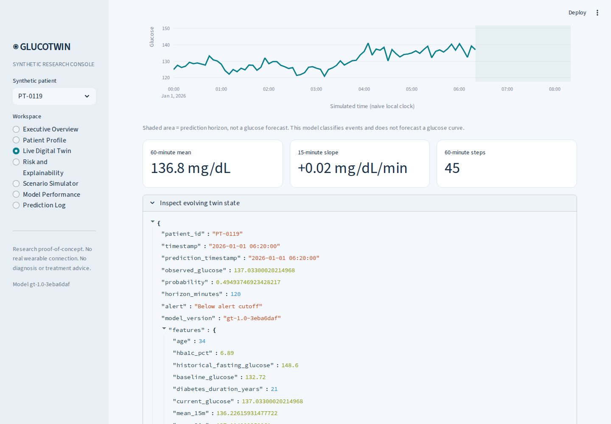

</details>


---

##  Problem Statement

Historical patient records and continuously changing sensor observations describe different aspects of a patient's state.

Historical measurements provide baseline context, while recent sensor observations describe the evolving trajectory. A predictive system must combine these information sources without using measurements that would not yet have been available at prediction time.

GlucoTwin investigates this problem through a reproducible synthetic experiment.

At each prediction timestamp, the model estimates whether a defined glucose threshold event will occur during the following two hours. The application then exposes the estimate, the features used, the data-quality state, and a record of the prediction.

The goal is to demonstrate a functioning, inspectable digital-twin architecture—not to claim clinical efficacy.

##  Healthcare Use Case

**Research use case:** Patient-conditioned monitoring and early prediction of synthetic glucose excursions.

The system explores how historical baseline information, recent glucose dynamics, activity observations, meal timing, and data quality can be incorporated into a continuously updated prediction workflow.

The prediction target is:

> At prediction time \(t\), determine whether any available simulated CGM reading exceeds 180 mg/dL at one of the future five-minute timestamps from \(t+5\) through \(t+120\) minutes.

The current reading is excluded from the future-event label. However, a patient may already be above the threshold at prediction time, so the main task includes persistent elevations as well as newly developing excursions.

A separate evaluation subset considers prediction timestamps at which the current glucose is at or below the threshold.

GlucoTwin does **not** provide a clinical diagnosis, treatment recommendation, personalized medication advice, or validated physiological intervention simulation.

##  Key Features

- **Persistent synthetic patient identities:** Connect historical profiles to individual sensor timelines.
- **Continuously updating state:** Maintain the current replay position, latest observation, engineered features, estimate, and prediction history.
- **Causal temporal features:** Construct rolling statistics and normalization using only information available at the prediction timestamp.
- **Shared training and inference pipeline:** Use the same feature-building function during training and application inference.
- **Patient-level data isolation:** Keep training, validation, calibration, and test patients disjoint.
- **Interactive sensor replay:** Advance through five-minute observations or skip one simulated hour.
- **Model sensitivity:** Inspect how changing individual feature values affects model output.
- **Scenario experiments:** Explore controlled changes to copied input histories without altering the original state.
- **Missing-data safeguards:** Withhold estimates when configured sensor-quality requirements are not satisfied.
- **Persistent audit logging:** Store issued predictions in SQLite and support CSV export.
- **Retrospective inspection:** Reveal the complete synthetic timeline only through an explicitly labeled retrospective view.
- **Reproducible evaluation:** Retain model metrics, test predictions, partition information, and automated tests.

##  Technical Architecture

```text
Historical Synthetic Patient Profiles
                |
                v
      Patient Context Loader
                |
                +----------------------+
                |                      |
                v                      v
      Historical Baseline       Synthetic CGM Stream
                                       |
                                       v
                              Timestamped Replay
                                       |
                                       v
                              Data-Quality Gate
                                       |
                                       v
                           Causal Feature Builder
                           (22 model input columns)
                                       |
                                       v
                          Trained Event Classifier
                                       |
                                       v
                         Probability + Review State
                                       |
                     +-----------------+----------------+
                     |                 |                |
                     v                 v                v
                Dashboard         Sensitivity       SQLite Audit
                                  & Scenarios       + CSV Export
                     |
                     v
              Evaluation & Retrospective Review
```

### Core components

| Component | Responsibility |
|---|---|
| `app.py` | Streamlit interface and dashboard navigation |
| `glucotwin/data.py` | Seeded synthetic patient and sensor generation |
| `glucotwin/features.py` | Causal feature engineering and target construction |
| `glucotwin/train.py` | Patient partitions, training, calibration, evaluation, and artifact export |
| `glucotwin/twin.py` | Replay state, model inference, and SQLite audit logging |
| `artifacts/model.joblib` | Trained estimator, calibration components, and prediction configuration |
| `artifacts/metrics.json` | Evaluation metrics and partition manifest |
| `artifacts/test_predictions.csv` | Held-out test predictions and outcomes |
| `tests/` | Temporal isolation, labels, state management, and integration tests |

The implementation is a **data-driven monitoring twin**, not a mechanistic physiological twin. It uses a shared population model conditioned on historical patient features rather than fitting an individualized physiological model for each patient.

##  AI/ML Model and Frameworks

**Primary model:** Scikit-learn histogram gradient boosting classifier.

The trained pipeline includes the estimator, calibration components, and configuration required to reproduce the prediction task.

| Component | Implementation |
|---|---|
| Event prediction | Histogram gradient boosting classifier |
| Baseline comparator | Glucose level plus positive trend rule |
| Personalization ablation | Dynamic-only classifier without historical/personalized features |
| Probability calibration | Sigmoid calibration using a separate patient partition |
| Explainability | Local median-replacement sensitivity analysis |
| Global feature importance | Permutation importance on validation data |
| Data processing | Python, NumPy, Pandas |
| Application | Streamlit |
| Persistent audit | SQLite |
| Automated testing | pytest |

### Feature groups

The model receives an enumerated vector of 22 features derived from:

- Current glucose and recent glucose statistics.
- Short-term glucose slope and variability.
- Recent activity and heart-rate observations.
- Meal timing.
- Historical patient characteristics and baseline-normalized values.
- Missingness indicators and elapsed time since the last actual glucose observation.

Future glucose, target labels, patient identifiers as predictive inputs, and hidden simulator response parameters are excluded from the estimator input.

Short glucose gaps may be forward-filled for up to three five-minute intervals. The pipeline does not backward-fill from future observations. A data-quality gate can withhold inference when configured missingness limits are exceeded.

##  Experimental Results

### Held-out synthetic test performance

The experiment uses 160 synthetic patients split by patient identity, not randomly mixed overlapping windows.

| Metric | Fused EHR + Sensor | Glucose + Trend Rule | Dynamic-Only Ablation |
|---|---:|---:|---:|
| Precision | 0.8727 | 0.7232 | 0.8831 |
| Recall | 0.8188 | 0.5540 | 0.8138 |
| F1 score | 0.8449 | 0.6274 | 0.8470 |
| Average precision | 0.9498 | 0.5621 | 0.9508 |
| Brier score | 0.0695 | 0.2383 | 0.0693 |

**Evaluation configuration**

- Training: 88 patients.
- Validation: 24 patients.
- Calibration: 24 patients.
- Final test: 24 patients.
- Held-out evaluation windows: 11,567.
- Test event prevalence: 36.21%.

### Confusion matrix: fused model

| Actual / Predicted | Negative | Positive |
|---|---:|---:|
| Negative | 6,879 | 500 |
| Positive | 759 | 3,429 |

The false-positive rate is approximately 6.78%. The 500 false-positive windows are not 500 independent alert episodes: overlapping windows can describe the same evolving event. Episode deduplication and alert cooldown analysis have not been implemented.

### Early-warning subset

For the 9,696 test windows where current glucose is at or below the event threshold:

- F1 score: 0.7447.
- Recall: 0.7000.
- Average precision: 0.8678.

This subset is more directly relevant to detecting excursions before the current observation crosses the threshold. Its performance is lower than the overall result and should be interpreted separately.

### Important findings

**1. The fused model outperforms the simple rule baseline.**  
Its held-out F1 score is approximately 0.845, compared with 0.627 for the glucose-plus-positive-trend rule.

**2. Personalization has not demonstrated an improvement in this experiment.**  
The dynamic-only ablation achieved an F1 score of approximately 0.847, slightly above the fused model's 0.845. Adding historical context does not automatically improve performance.

**3. Calibration did not improve the test Brier score.**  
The raw Brier score was approximately 0.06867, compared with 0.06952 after calibration. Lower is better. Brier score reflects both calibration and other aspects of probabilistic prediction.

**4. Synthetic performance is not clinical validation.**  
The model may exploit the simulator's programmed meal schedules, baseline differences, and response equations. The reported results do not establish performance on real patients or real CGM devices.

All results are generated by the experiment and stored in `artifacts/metrics.json`. No claim of statistical significance or clinical superiority is made.

## 🔬 Data Generation and Scientific Integrity

The bundled experiment contains 160 fictional patients, each with seven days of five-minute sensor observations.

The simulator introduces patient-specific baselines, varying meal-response strengths, jittered meal times, delayed glucose-response kernels, activity patterns, circadian variation, prior completed sleep, autocorrelated noise, heart-rate variation, random missing observations, and a contiguous sensor gap for each patient.

These are explicit generator assumptions, not discoveries about human physiology.

The historical baseline is constructed before the sensor stream. Features use only past and current observations. Training and evaluation are partitioned by patient identity to avoid distributing overlapping windows from the same patient across the different partitions.

The automated temporal-isolation test replaces later sensor values and verifies that earlier feature rows remain unchanged.

Only anchors with a complete future horizon are labeled. Training and evaluation use 15-minute anchors after a 60-minute warmup, while live inference can update every five minutes. The event threshold and prediction horizon belong to the trained model bundle and should be changed through retraining.

### Known limitations

- No external clinical validation or prospective patient study.
- No demonstrated improvement in health outcomes.
- No demonstrated performance gain from historical personalization in this seeded experiment.
- No validated patient-level uncertainty intervals.
- No subgroup fairness evaluation.
- No production authentication or multi-user synchronization.
- No alert episode deduplication or cooldown evaluation.
- No mechanistic modeling of medication, meal absorption, or exercise physiology.
- No validated causal explanations or clinical intervention simulation.

These limitations define the current scope of the project and the work needed before any consideration of clinical use.

##  Getting Started

### Requirements

- Python 3.11 or 3.12.
- Git.
- Internet access for the initial dependency installation.

The application runs locally after dependencies have been installed. No API keys, cloud services, or external accounts are required.

### 1. Clone the repository

```bash
git clone https://github.com/RajVamshi05/GlucoTwin.git
cd GlucoTwin
```

### 2. Create and activate a virtual environment

**Windows PowerShell**

```powershell
python -m venv .venv
.venv\Scripts\Activate.ps1
```

**macOS / Linux**

```bash
python -m venv .venv
source .venv/bin/activate
```

### 3. Install dependencies

```bash
python -m pip install -r requirements.txt
```

### 4. Launch the application

```bash
python -m streamlit run app.py
```

Open [http://localhost:8501](http://localhost:8501) in your browser.

The supplied package contains generated sensor data and the trained model, allowing you to inspect the application without retraining first.

**Security note:** Only load the trusted bundled `artifacts/model.joblib` file. Joblib and other pickle-based formats can execute code when deserialized.

##  Reproduce the Experiment

Stop the running Streamlit process before retraining. Restart it afterwards to clear cached model and data resources.

```bash
python -m glucotwin.train --patients 160 --days 7 --seed 2026 --threshold 180 --horizon 120
python -m pytest -q
python scripts/build_submission.py
```

The training command regenerates the synthetic experiment and rebuilds the trained artifacts. The test suite checks temporal feature isolation, exact target boundaries, missing-data withholding, disjoint patient partitions, replay state, and dashboard integration.

For environments affected by excessive BLAS/OpenMP worker creation, set the following variables before training:

```bash
OMP_NUM_THREADS=2
OPENBLAS_NUM_THREADS=2
```

Direct dependency versions are pinned, and `environment-lock.txt` records the tested environment. Minor floating-point differences may occur across platforms.

Optional screenshot and video-production tools are not required to run the application. The bundled demo is an edited walkthrough using actual application captures and synthesized narration, rather than an uninterrupted live recording.

## 📁 Repository Structure

```text
.
├── app.py
├── glucotwin/
│   ├── data.py
│   ├── features.py
│   ├── train.py
│   └── twin.py
├── data/
│   ├── patients.csv
│   └── sensors/
├── artifacts/
│   ├── model.joblib
│   ├── metrics.json
│   └── test_predictions.csv
├── docs/
│   ├── images/
│   │   ├── 01-executive-overview.png
│   │   ├── 02-patient-profile.png
│   │   ├── 03-live-digital-twin.png
│   │   ├── 04-explainability.png
│   │   ├── 05-scenario-simulator.png
│   │   ├── 06-model-performance.png
│   │   ├── 07-prediction-log.png
│   ├── ARCHITECTURE.pdf
│   ├── GLUCOTWIN_PRESENTATION.pdf
│   ├── METHODOLOGY.md
│   ├── DATA_DICTIONARY.md
│   ├── MODEL_CARD.md
│   ├── DEMO_SCRIPT.md
│   └── SUBMISSION_CHECKLIST.md
├── scripts/
├── tests/
├── requirements.txt
├── environment-lock.txt
├── LICENSE
└── THIRD_PARTY.md
```

##  Team and Affiliation

**Project name:** GlucoTwin  
**Registered team name:** Team MeowMeow

| Participant | Institution | Academic program |
|---|---|---|
| J K Raj Vamshi Thakur | Indian Institute of Information Technology, Allahabad | B.Tech, Electronics and Communication Engineering, 2023–2027 |
| Swasti Mishra | IIT (ISM) Dhanbad | B.Tech, Electronics and Communication Engineering, 2023-2027 |

##  License and Third-Party Components

Project code, documentation, and newly generated synthetic data are released under the [MIT License](LICENSE).

Third-party dependencies remain subject to their respective licenses, documented in [`THIRD_PARTY.md`](THIRD_PARTY.md).

No real patient records, real patient identities, proprietary patient datasets, or trained clinical models were used in this experiment.

##  Final Note

GlucoTwin demonstrates how a continuously updating, patient-conditioned prediction system can combine historical context with a time-evolving sensor stream while retaining explicit temporal safeguards, inspectable model behavior, missing-data handling, held-out evaluation, and persistent auditing.

Its strongest contribution is not a claim that synthetic predictions are clinically accurate. It is the integration of these engineering and experimental components into a reproducible research prototype.

The next step would be independent evaluation using appropriately governed real-world data, prospective validation, and a rigorous investigation of whether historical personalization provides reliable value beyond recent sensor observations.

**GlucoTwin — a reproducible digital-twin research prototype, built to make every prediction inspectable.**
